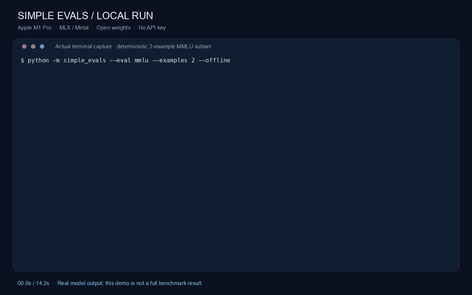
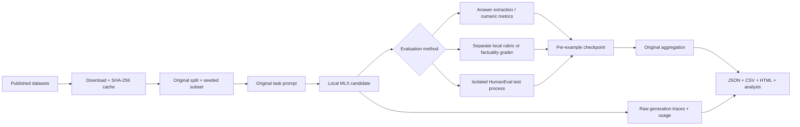
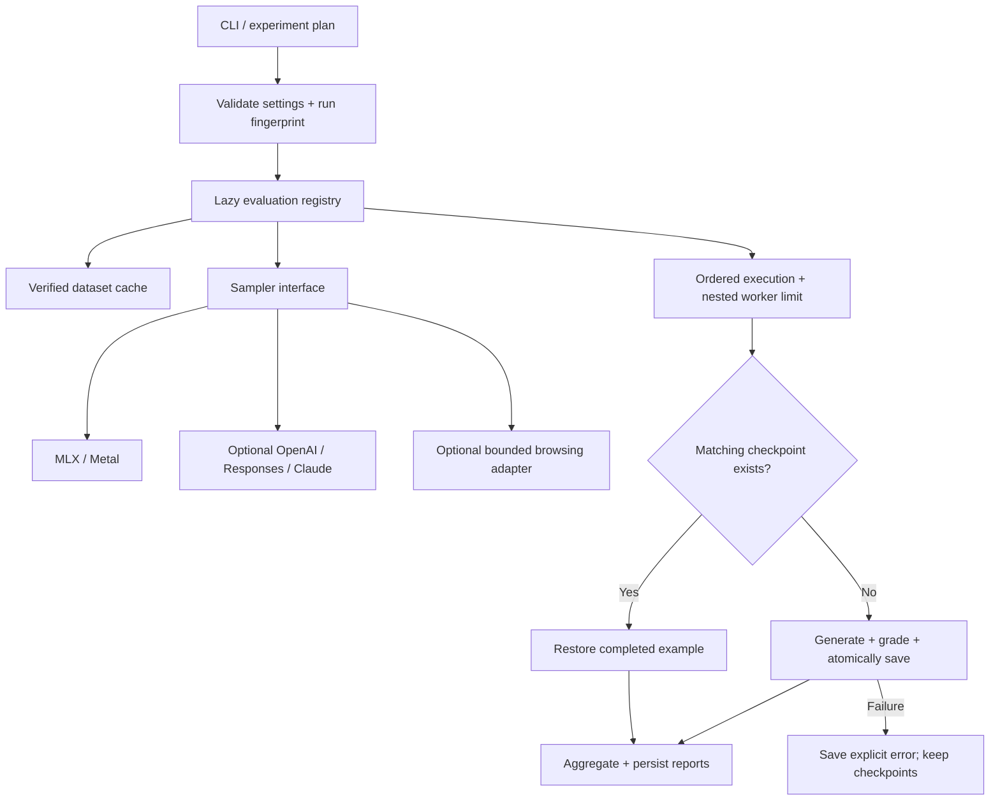
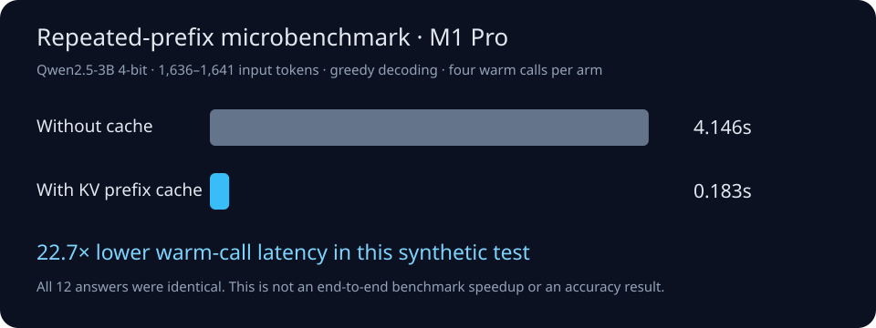

# ReproEval

[English](README.md) · [简体中文](README.zh-CN.md) · [Experiment report](experiments/REPORT.md) · [Paper audit](docs/PAPER_AUDIT.md)

A reproducible language model evaluation framework covering reasoning, coding, factuality, and multilingual benchmarks, with local inference, automated grading, resumable experiments, and traceable reports.

Download the original data, generate answers locally with MLX, grade them, resume interrupted runs, and inspect reproducible reports. The original emphasis on **simple zero-shot chain-of-thought evaluation** is preserved, including the three-shot DROP exception.

This is an independent adaptation of the archived upstream project. The original README and historical scores are preserved in [docs/UPSTREAM_README.md](docs/UPSTREAM_README.md). This suite spans nine benchmark families and multiple papers. **Local open-weight results are not the original papers' model results; implemented support and completed experiments are separate claims.** See the [audit](docs/PAPER_AUDIT.md) and [measured coverage](experiments/REPORT.md).

The recorded experiment campaign ended early on November 17, 2026. Eight full evaluation entries completed; remaining work is explicitly incomplete and no background experiments are running. See the [termination record](experiments/termination.json). Large raw artifacts are included as [verified, restorable archives](experiments/artifacts/README.md).

## Watch it run

[](docs/assets/demo.mp4)

[MP4 video](docs/assets/demo.mp4) · [Autoplay video page](docs/demo.html) · [Raw terminal recording](docs/assets/demo.cast)

The animation is rendered from a real, timestamped terminal recording. GitHub README rendering does **not** support reliable automatic MP4 playback; the inline GIF loops automatically. On HTML renderers that permit video, the player below uses muted autoplay. Browser settings can still block autoplay. See [GitHub’s rendering pipeline](https://github.com/github/markup) and [MDN’s autoplay guidance](https://developer.mozilla.org/en-US/docs/Web/Media/Guides/Autoplay).

<video src="docs/assets/demo.mp4" poster="docs/assets/demo-poster.png" autoplay muted loop playsinline controls width="960"></video>

## Quick start on M1 / M2 / M3 / M4

Validated on **Apple M1 Pro, 16 GB unified memory, macOS 26.6.1, native arm64 Python 3.11**. No CUDA, Docker, API key or paid model endpoint is required for local evaluation. First use downloads model weights and public datasets. Other macOS versions depend on availability of compatible MLX wheels; the exact lock below targets the tested environment, not every macOS release.

```bash
git clone https://github.com/InfronAI/ReproEval.git
cd ReproEval
brew install python@3.11
sh scripts/bootstrap_macos.sh

# Verify native Python and Metal, without disclosing credentials.
.venv/bin/python -m simple_evals doctor

# An actual model evaluation; default backend is MLX.
.venv/bin/python -m simple_evals \
  --eval mmlu --examples 5 --output experiments/runs/quickstart

# Inspect the self-contained result report.
open experiments/runs/quickstart/index.html
```

The default candidate is [`Qwen2.5-0.5B-Instruct-4bit`](https://huggingface.co/mlx-community/Qwen2.5-0.5B-Instruct-4bit). Evaluations needing a judge use a separate [`Qwen2.5-3B-Instruct-4bit`](https://huggingface.co/mlx-community/Qwen2.5-3B-Instruct-4bit). These small models make the workflow practical; their limitations, especially judge reliability and multilingual accuracy, must be considered when interpreting scores. MLX serializes inference to bound unified-memory use. Use larger open models through `--model` and `--grader-model` if your memory and time budget allow.

For an existing Python ≥3.11 environment:

```bash
python3.11 -m venv .venv
.venv/bin/python -m pip install -e '.[mlx,humaneval,dev,browse]'
.venv/bin/python -m pytest -q
```

[requirements-macos-arm64.lock](requirements-macos-arm64.lock) captures exact tested dependency versions. Recreate that environment with `pip install -r requirements-macos-arm64.lock` followed by `pip install --no-deps -e .`. Portable core installation is `pip install -e .`; optional extras are `mlx`, `humaneval`, `anthropic`, `browse`, `analysis`, and `dev`.

## Saved local results

All 12 original evaluator entries and all 15 MMLU language entry points completed real small-sample workflow checks. Two complete splits were also measured with the 0.5B candidate, temperature 0.5 and a 768-token output cap:

| Evaluation | Actual scope | Result |
|---|---|---:|
| GPQA Diamond | 198 questions, one draw each | 17/198 = 8.59% |
| HumanEval | 164 tasks, one tested program each | pass@1 = 39/164 = 23.78% |

GPQA had 84 output-limit hits and 110 missing final-answer markers; these limitations are included in the score. [Per-domain and per-task analysis](experiments/complete_split_analysis/analysis.md), [raw run artifacts](experiments/runs/m1-complete-small/analysis.md), and [39-test validation evidence](experiments/validation/verification_summary.json) are saved. Larger repeated-sampling experiments have separate live status in the [experiment report](experiments/REPORT.md).

## Experiments, step by step

```bash
# 1. Cache and checksum all released source objects (including translated MMLU).
.venv/bin/python -m simple_evals prepare

# 2. Exercise every original evaluator; MGSM uses 5 examples PER LANGUAGE.
.venv/bin/python scripts/run_plan.py experiments/plans/local-pilot.json

# 3. Resume exactly the same configuration after interruption.
.venv/bin/python scripts/run_plan.py experiments/plans/local-pilot.json --resume

# 4. Inspect the full experiment schedule before running it.
.venv/bin/python scripts/run_plan.py experiments/plans/full-reference.json --dry-run

# 5. Run all scheduled full datasets and supported paper extensions.
# This is substantial work: many thousands of generations and grading calls;
# multilingual MMLU alone adds 196,588 questions. It can take multiple days.
.venv/bin/python scripts/run_plan.py experiments/plans/full-reference.json

# 6. Rebuild reports from stored results; no inference or API calls.
.venv/bin/python -m simple_evals analyze --output experiments/runs/m1-verified-suite
```

The full plan uses pinned model revisions and records every stage. It covers the released suite, original MATH-5000, additional 200-sample HumanEval runs at temperatures 0.2 and 0.8, 14 additional MMLU translations, SimpleQA calibration, bounded browsing budgets, and HealthBench physician/reference modes. It does not recreate unpublished agent internals or historical model training. **A checked-in plan is not evidence that its full runs have completed.** The [experiment report](experiments/REPORT.md) lists actual completed, failed and pending work.

A focused full run is also possible:

```bash
.venv/bin/python -m simple_evals --eval gpqa --full --n-repeats 1 \
  --max-tokens 2048 --output experiments/runs/gpqa-full
```

`--full` selects all rows. `--paper-repeats` uses the upstream CLI's ten MATH/GPQA repeats; `--n-repeats` explicitly overrides this. `--examples` cannot be combined with `--full`; subset sampling and multiple repeats are rejected where the upstream evaluator does not support their combination. `--math-split math_test` selects original 5,000-row MATH; the default is explicitly `math_500_test`.


For a long run detached from the terminal, use the managed runner. It writes a PID, stage state and log under `experiments/jobs/`:

```bash
.venv/bin/python scripts/manage_experiments.py start
.venv/bin/python scripts/manage_experiments.py status
.venv/bin/python scripts/manage_experiments.py stop
# After stopping, preserve all settings and resume:
.venv/bin/python scripts/manage_experiments.py start --resume
```

The default managed plan is `full-reference.json`. Use `--plan experiments/plans/local-validation.json` for the actual validation protocol (one example per original evaluator plus complete single-draw GPQA/HumanEval). The larger example pilot is a separate output directory. Public-web results, background progress and all source differences remain visible in the report.

## Supported evaluations

| CLI name | Released full split | Grading / output |
|---|---:|---|
| `mmlu`, `mmlu_ZH-CN`, etc. | 14,042 per language | Letter accuracy, four subject categories |
| `math` | 500 or 5,000 | Original equivalence-grader prompt |
| `gpqa` | 198 Diamond questions | Seeded permutations and accuracy |
| `mgsm` | 250 × 11 languages | Numeric accuracy and language groups |
| `drop` | 9,536 dev questions | EM, F1 **on a 0–100 scale**, three demonstrations |
| `humaneval` | 164 tasks | Actual code tests, unbiased pass@k |
| `simpleqa` | 4,326 | Correct / incorrect / not attempted, attempted accuracy, F1 |
| `browsecomp` | 1,266 | Decrypted questions, corrected yes/no grader |
| `healthbench` | 5,000 | Weighted rubric criteria, clipped aggregate, tags |
| `healthbench_hard` | 1,000 | Same rubric procedure |
| `healthbench_consensus` | 3,671 source rows | Same rubric procedure |
| `healthbench_meta` | 29,511 source rows | Model/physician pairwise agreement and balanced F1 |
| `simpleqa_calibration` | 4,326 × configurable draws | Confidence/frequency bins, consensus@n, pass@n |

`--eval all` selects the 12 original entries; calibration is an explicit additional experiment. The dataset inventory is measured from downloaded source files, not inferred from README descriptions.

```bash
# Calibration: temperature 1, 100 draws/question, Appendix-D-style curves.
.venv/bin/python -m simple_evals --eval simpleqa_calibration --examples 3 \
  --temperature 1 --calibration-samples 100 --output experiments/runs/calibration

# Optional browsing adapter: at most 5 search/open actions per question.
.venv/bin/python -m simple_evals --eval browsecomp --examples 3 --browse \
  --browse-steps 5 --output experiments/runs/browse

# Original physician/reference evaluation modes remain available.
.venv/bin/python -m simple_evals --eval healthbench --examples 3 \
  --physician-group 'Group 2' --reference-completions \
  --output experiments/runs/physician-references

# The original multilingual entry point now shares the unified runner.
.venv/bin/python -m simple_evals.run_multilingual_mmlu --examples 5 \
  --output experiments/runs/multilingual
```

Calibration keeps all requested draws. Invalid or conflicting JSON is recorded as a failed structured-answer draw for pass/consensus; confidence statistics use only valid confidence values and report coverage. It is never repaired by selecting one of several conflicting confidences.

Without `--browse`, BrowseComp is a **closed-book baseline**. The optional agent uses public search and bounded page reads; all observations and errors are retained. It is not OpenAI's proprietary browsing agent. Search availability and changing web content affect reproducibility.

HumanEval executes generated code in fresh timed processes. On macOS, the OS sandbox denies networking and writes outside the temporary directory, and restricts reading the home directory. The Python reliability guard is also enabled. Linux runs require an isolated container and the explicit `SIMPLE_EVALS_ALLOW_UNSANDBOXED_CODE=1` setting. Configure `--samples-per-task`, `--pass-k`, and `--code-timeout`; k values exceeding the sample count are omitted, never extrapolated.

## Data flow



## Structure and execution flow



```text
src/simple_evals/
  cli.py, registry.py         installation-friendly entry point and lazy dispatch
  *_eval.py                  retained benchmark implementations + calibration
  sampler/                   MLX, API and optional browsing adapters
  datasets.py, runtime.py     verified cache, deterministic seeds, resume journal
  code_execution.py          macOS sandbox and subprocess timeouts
  analysis.py                reports built from saved measurements
experiments/
  plans/                     explicit pilot and full schedules
  runs/                      manifests, traces, per-example data and reports
  dataset_inventory.json     actual counts and HumanEval archive hash
  datasets.json              official source URLs and SHA-256 receipts
  REPORT.md                  measured results and remaining work
scripts/                     bootstrap, plan runner and genuine demo recorder
tests/                       upstream scoring tests and regression/integration tests
docs/                        paper audit, demo, preserved upstream documentation
healthbench_scripts/         original exploratory analysis notebook
```

## Reproducibility and failures

Each run stores its configuration, source hashes and source snapshot, git baseline, dependencies, platform, resolved model revisions, source-data receipts, raw model/grader traces, input-bearing checkpoints, conversations, metrics and HTML. Independent repeated generations receive distinct seeds; completed examples are restored without new inference. Changed code/configuration/dependencies or checkpoint inputs prevent accidental mixing of experiments. Request/grader failures are not converted into wrong answers; candidate output-format failures remain observable model behavior. Reports can be regenerated without a model. The managed runner executes a frozen package/plan snapshot, so later workspace edits cannot change an ongoing full job. [Model-file hashes](experiments/models.json) and [prompt-preservation checks](experiments/prompt_preservation.json) provide additional provenance.

Dataset sampling retains the upstream seeds (0 generally; 42 for DROP). `--seed` controls local generation. Exact bitwise inference across different MLX/macOS versions is not promised. HealthBench bootstrap uses a fixed RNG. Full prompts are never silently truncated: exceeding `--max-context` fails explicitly, and output token-limit hits are recorded. Inspect these before comparing scores.

After prefetching data and weights, `--offline` forbids dataset/model downloads. `--resume` must use the same settings and environment; failed items rerun, completed items do not. Running processes use a lock to protect the output directory.

## Compare models

The original multi-model workflow is available as a sequential, memory-bounded comparison runner. Every model uses the same requested settings and evaluator seeds, and a combined CSV/JSON is saved:

```bash
.venv/bin/python scripts/compare_models.py \
  --models mlx-community/Qwen2.5-0.5B-Instruct-4bit,mlx-community/Qwen2.5-3B-Instruct-4bit \
  --eval mmlu --examples 2 --output experiments/comparison/new-comparison
```

The single-run CLI accepts one model ID; use this runner for comma-separated model lists. Small comparison subsets validate execution, not model rankings.

## Optional API backends

Original sampling interfaces remain available without loading them for local runs:

```bash
# Configure credentials in your shell, never in committed files.
.venv/bin/python -m simple_evals --backend openai --model YOUR_MODEL \
  --grader-backend openai --grader-model YOUR_GRADER \
  --eval simpleqa --examples 5 --output experiments/runs/api-check
```

Backends: `mlx`, `openai`, `o-chat`, `responses`, `anthropic`. OpenAI-compatible local servers use `OPENAI_BASE_URL` and their expected key setting. Use `--reasoning-effort` and `--system-message` where supported. Anthropic requires the `anthropic` extra. API requests use bounded SDK retries and a timeout. The existing HealthBench Professional flags remain available; the [paper audit](docs/PAPER_AUDIT.md) explains their relationship to the original HealthBench protocol.

## Validation and demo regeneration

```bash
.venv/bin/python -m pytest -q
.venv/bin/ruff check src tests scripts
.venv/bin/python -m build

# Requires ffmpeg (brew install ffmpeg) and the dev extra.
# Use a fresh experiments/runs/demo output directory for a new recording.
.venv/bin/python scripts/record_demo.py --output experiments/runs/demo-new
```

Tests cover BrowseComp's corrected positive grades, saved SimpleQA metrics, bounded grading retries, empty/nested maps, checkpoint recovery and invalidation, missing CSV values, escaped reports, deterministic bootstrap, calibration boundaries, and real macOS code execution including timeouts and network denial.


## Measured optimization



MLX reuses an LRU cache of matching prompt prefixes, capped at 256 MiB per sampler and two entries. Candidate and grader caches stay separate. In the recorded synthetic A/B, four warm calls averaged **4.146 s without caching vs 0.183 s with caching**; all twelve greedy answers matched. This measures repeated-prefix latency, not an overall suite speedup. [Raw measurements](experiments/cache_performance.json) and [reproduction script](scripts/benchmark_cache.py) are included. Disable with `--no-prefix-cache`.

## Attribution

Code remains under [MIT](LICENSE). Dataset and model licenses remain their authors' licenses; see the original links in the [upstream README](docs/UPSTREAM_README.md) and the [paper audit](docs/PAPER_AUDIT.md). The [MLX LM project](https://github.com/ml-explore/mlx-lm) provides native Apple Silicon inference. Benchmark data and canaries must remain evaluation material, not training data.
