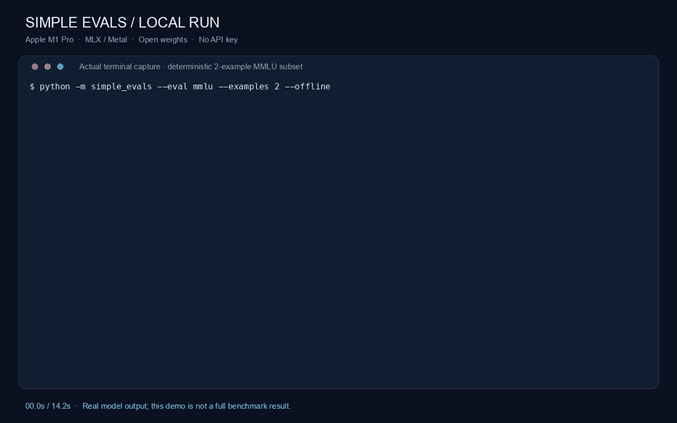
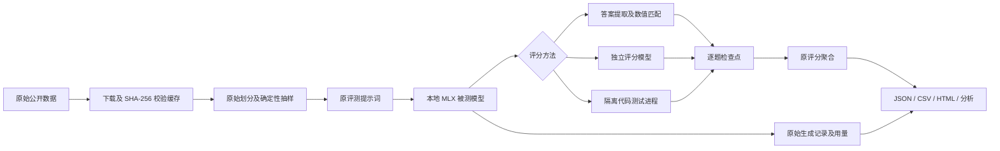
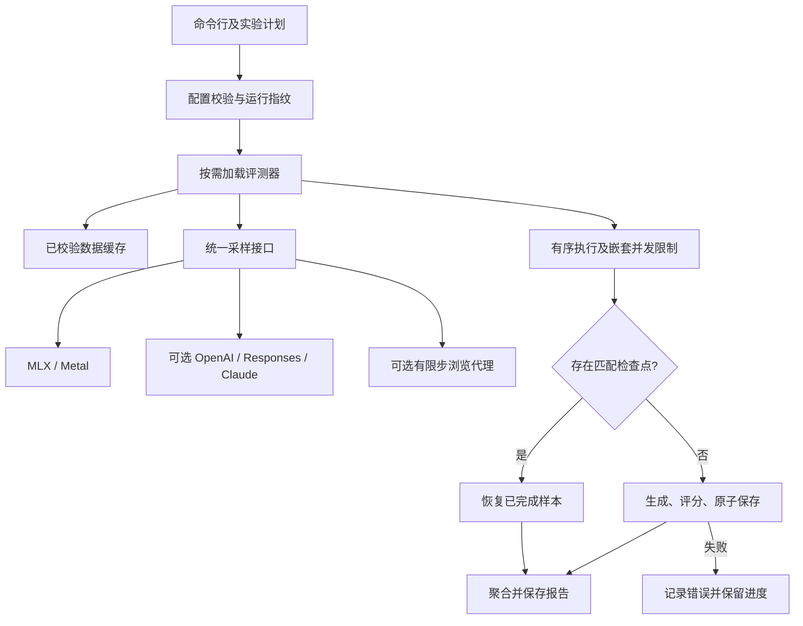
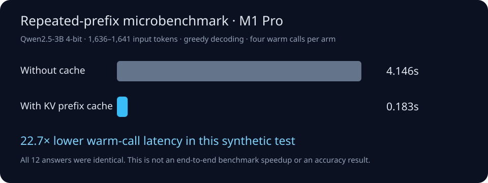

# ReproEval

[English（默认）](README.md) · [简体中文](README.zh-CN.md) · [实验报告](experiments/REPORT.md) · [论文对照审计](docs/PAPER_AUDIT.md)

可复现的语言模型评测框架，覆盖推理、代码、事实准确性及多语言基准，支持本地推理、自动评分、实验断点恢复与可追溯报告。

下载原始数据、使用 MLX 本地生成答案、评分、断点恢复，并输出分析报告。保留项目的核心思想：**简单提示词、零样本思维链评测**；DROP 继续采用原有的三个示例。

这是归档上游项目的独立适配版本。[上游 README 与历史成绩](docs/UPSTREAM_README.md)完整保留。仓库包含九类基准和多篇论文，并不存在单一“原始论文”。**本地开源模型成绩不等同于论文成绩；支持运行某项实验，也不意味着已经完成该项全量实验。** 具体实现差异与实测范围见[论文审计](docs/PAPER_AUDIT.md)和[实验报告](experiments/REPORT.md)。

本次实验已于 2026 年 11 月 17 日按要求提前结束，完成 8 个全量评测入口，其余工作明确标注为未完成，后台实验均已停止。参见[结束记录](experiments/termination.json)。大型原始记录以[可校验、可还原的归档](experiments/artifacts/README.md)随仓库提供。

## 自动播放演示

[](docs/assets/demo.mp4)

[MP4 视频](docs/assets/demo.mp4) · [自动播放页面](docs/demo.html) · [原始终端录制](docs/assets/demo.cast)

动画由真实运行的终端记录生成。GitHub README 不支持可靠的 MP4 自动播放，因此内嵌自动循环 GIF；支持 HTML 视频的渲染器可使用下方静音自动播放播放器。浏览器偏好仍可能阻止自动播放，参见 [GitHub 渲染流程](https://github.com/github/markup)与 [MDN 自动播放说明](https://developer.mozilla.org/en-US/docs/Web/Media/Guides/Autoplay)。

<video src="docs/assets/demo.mp4" poster="docs/assets/demo-poster.png" autoplay muted loop playsinline controls width="960"></video>

## M1 快速开始

已在 **Apple M1 Pro、16 GB 统一内存、macOS 26.6.1、原生 arm64 Python 3.11** 上验证。本地运行不需要 CUDA、Docker、API Key 或付费接口；首次使用需要下载公开数据与模型权重。其他 macOS 版本取决于是否存在兼容的 MLX 安装包，精确依赖锁定文件仅对应实测环境。

```bash
git clone https://github.com/InfronAI/ReproEval.git
cd ReproEval
brew install python@3.11
sh scripts/bootstrap_macos.sh

# 检查原生 Python 和 Metal，不输出密钥内容。
.venv/bin/python -m simple_evals doctor

# 真实本地模型评测，默认使用 MLX。
.venv/bin/python -m simple_evals \
  --eval mmlu --examples 5 --output experiments/runs/quickstart

open experiments/runs/quickstart/index.html
```

默认被测模型为 [`Qwen2.5-0.5B-Instruct-4bit`](https://huggingface.co/mlx-community/Qwen2.5-0.5B-Instruct-4bit)，需要模型评分的任务使用独立的 [`Qwen2.5-3B-Instruct-4bit`](https://huggingface.co/mlx-community/Qwen2.5-3B-Instruct-4bit)。小模型适合验证完整流程，但评分能力、多语言能力和长输出稳定性有限，不能据此直接比较原论文排行榜。可通过 `--model` 和 `--grader-model` 切换更大模型；MLX 串行生成，限制统一内存占用。

已有 Python ≥3.11 时：

```bash
python3.11 -m venv .venv
.venv/bin/python -m pip install -e '.[mlx,humaneval,dev,browse]'
.venv/bin/python -m pytest -q
```

[requirements-macos-arm64.lock](requirements-macos-arm64.lock)记录实测依赖版本。精确重建时先安装该文件，再执行 `pip install --no-deps -e .`。跨平台基础安装为 `pip install -e .`；可选依赖包括 `mlx`、`humaneval`、`anthropic`、`browse`、`analysis`、`dev`。

## 已保存的本地实测结果

原有 12 个评测入口、全部 15 个 MMLU 语言入口均已完成真实小样本流程验证。另外，使用 0.5B 被测模型、温度 0.5、768 token 输出上限完成了两个完整数据划分：

| 评测 | 实际范围 | 结果 |
|---|---|---:|
| GPQA Diamond | 198 题，每题生成一次 | 17/198 = 8.59% |
| HumanEval | 164 个任务，每题实际测试一个程序 | pass@1 = 39/164 = 23.78% |

GPQA 有 84 次生成触及输出上限，110 次缺少规定的最终答案标记，这些失败已计入分数。[按学科及任务分析](experiments/complete_split_analysis/analysis.md)、[原始运行记录](experiments/runs/m1-complete-small/analysis.md)和 [39 项测试验证证据](experiments/validation/verification_summary.json)均已保存。更大规模的重复采样实验状态见[实验报告](experiments/REPORT.md)。

## 按步骤运行实验

```bash
# 1. 缓存并校验全部公开数据，包括多语言 MMLU。
.venv/bin/python -m simple_evals prepare

# 2. 验证全部原有评测入口；MGSM 为每种语言 5 题。
.venv/bin/python scripts/run_plan.py experiments/plans/local-pilot.json

# 3. 以相同配置恢复中断的运行。
.venv/bin/python scripts/run_plan.py experiments/plans/local-pilot.json --resume

# 4. 预览完整实验计划。
.venv/bin/python scripts/run_plan.py experiments/plans/full-reference.json --dry-run

# 5. 执行全量数据与已支持的论文扩展实验。
# 该计划可能持续数天：仅额外 14 语言 MMLU 就包含 196,588 题。
.venv/bin/python scripts/run_plan.py experiments/plans/full-reference.json

# 6. 从已保存数据重新生成分析，不调用模型。
.venv/bin/python -m simple_evals analyze --output experiments/runs/m1-verified-suite
```

完整计划固定模型版本，包含原有评测、原始 MATH 的 5,000 题、温度 0.2／0.8 下每题采样 200 次的 HumanEval、多语言 MMLU、SimpleQA 校准、浏览预算对照、HealthBench 医师与参考回答评估。它不包括未公开的研究代理内部实现和历史模型训练。**配置文件不是实验完成证据**；实际完成、失败、待运行范围以[实验报告](experiments/REPORT.md)为准。

单项完整数据集示例：

```bash
.venv/bin/python -m simple_evals --eval gpqa --full --n-repeats 1 \
  --max-tokens 2048 --output experiments/runs/gpqa-full
```

`--full` 表示全部数据行；`--paper-repeats` 使用上游 CLI 的 MATH/GPQA 十次重复；`--n-repeats` 可显式覆盖。`--examples` 与 `--full` 互斥，不支持“抽样加重复”的原评测器会直接报错。默认 MATH 为 500 题，使用 `--math-split math_test` 选择原始 5,000 题。


持续运行可使用后台管理命令，PID、阶段状态与日志写入 `experiments/jobs/`：

```bash
.venv/bin/python scripts/manage_experiments.py start
.venv/bin/python scripts/manage_experiments.py status
.venv/bin/python scripts/manage_experiments.py stop
# 停止后，保持原配置恢复：
.venv/bin/python scripts/manage_experiments.py start --resume
```

默认后台计划为 `full-reference.json`。指定 `--plan experiments/plans/local-validation.json` 可运行实际验证协议：每个原评测入口一题，加上 GPQA／HumanEval 全部题目的一次采样。较大的 pilot 示例使用独立输出目录；不要把后台运行状态当作全量完成。

## 评测范围

| 参数 | 公开完整数据规模 | 评分与输出 |
|---|---:|---|
| `mmlu`、`mmlu_ZH-CN` 等 | 每种语言 14,042 | 选项准确率及四类学科指标 |
| `math` | 500 或 5,000 | 原有等价答案评分提示词 |
| `gpqa` | Diamond 198 | 固定随机种子的选项排列、准确率 |
| `mgsm` | 250 × 11 语言 | 数值答案准确率及语言分组 |
| `drop` | 验证集 9,536 | EM、**0–100 范围**的 F1、三个示例 |
| `humaneval` | 164 | 实际执行测试、无偏 pass@k |
| `simpleqa` | 4,326 | 正确／错误／未尝试、尝试条件准确率及 F1 |
| `browsecomp` | 1,266 | 数据解密、修复后的 yes/no 评分 |
| `healthbench` | 5,000 | 加权正负评分项、裁剪后聚合、标签指标 |
| `healthbench_hard` | 1,000 | 同上 |
| `healthbench_consensus` | 3,671 数据行 | 同上 |
| `healthbench_meta` | 29,511 数据行 | 模型与医师一致性、平衡 F1 |
| `simpleqa_calibration` | 4,326 × 指定采样次数 | 置信度／频率分箱、consensus@n、pass@n |

`--eval all` 选择原有 12 个入口，校准实验需显式指定。数据规模由实际下载内容统计；不同来源的数据行不应一律视为独立问题。

```bash
# 校准：温度 1，每题 100 次生成。
.venv/bin/python -m simple_evals --eval simpleqa_calibration --examples 3 \
  --temperature 1 --calibration-samples 100 --output experiments/runs/calibration

# 浏览代理：每题最多 5 次搜索／打开网页动作。
.venv/bin/python -m simple_evals --eval browsecomp --examples 3 --browse \
  --browse-steps 5 --output experiments/runs/browse

# 保留原有医师／参考回答评估模式。
.venv/bin/python -m simple_evals --eval healthbench --examples 3 \
  --physician-group 'Group 2' --reference-completions \
  --output experiments/runs/physician-references

# 全部 15 种语言的 MMLU，共用可恢复运行器。
.venv/bin/python -m simple_evals.run_multilingual_mmlu --examples 5 \
  --output experiments/runs/multilingual
```

校准保留全部指定采样次数。无效或冲突的 JSON 被记为结构化回答失败；置信度统计只使用有效数值并报告覆盖率，不会从多个冲突置信度中随意选择一个。

不加 `--browse` 的 BrowseComp 是**闭卷基线**。本地浏览代理保留搜索结果、网页内容和错误，但不能等同于 OpenAI 未公开的研究代理；搜索服务和网页变化会影响复现。

HumanEval 使用独立进程和超时限制。macOS 系统沙箱限制联网、临时目录以外的写入以及用户主目录读取，同时启用原有 Python 防护。Linux 需要隔离容器，并显式设置 `SIMPLE_EVALS_ALLOW_UNSANDBOXED_CODE=1`。`--samples-per-task`、`--pass-k`、`--code-timeout` 可配置；超过采样数量的 k 不会计算。

## 数据流图



## 结构流程图



目录结构：

```text
src/simple_evals/
  cli.py, registry.py       统一入口及按需分派
  *_eval.py                原有评测实现和校准扩展
  sampler/                 MLX、API、可选浏览适配器
  datasets.py, runtime.py   数据缓存、种子、断点恢复
  code_execution.py        macOS 沙箱及代码执行超时
  analysis.py              从已保存记录生成分析
experiments/
  plans/                   小规模验证与完整实验计划
  runs/                    配置、原始轨迹、逐题结果和报告
  dataset_inventory.json   实际行数与 HumanEval 数据哈希
  datasets.json            原始 URL、文件大小、SHA-256
  REPORT.md                实测结论与剩余工作
scripts/                   安装、实验计划、真实演示录制
tests/                    上游与新增回归／集成测试
docs/                     论文审计、演示、原始文档
healthbench_scripts/       保留的原始探索分析 notebook
```

## 可复现性与失败处理

每次运行保存配置、源代码哈希及快照、Git 基线、依赖版本、平台、模型版本、数据校验记录、原始生成与评分轨迹、含输入的逐题检查点、对话、指标和 HTML。重复采样使用不同种子；已完成样本恢复时不重新调用模型。代码、配置、依赖或输入改变时拒绝混用检查点。后台管理器使用冻结的代码与计划快照，后续工作区编辑不会改变正在执行的全量任务。[模型文件哈希](experiments/models.json)与[原始提示词一致性检查](experiments/prompt_preservation.json)也已保存。

数据抽样保留上游种子：通常为 0，DROP 为 42；`--seed` 控制本地生成。不同 MLX/macOS 版本不保证逐位一致。HealthBench 的 bootstrap 使用固定随机数。输入超过 `--max-context` 会明确失败，不静默裁剪；达到输出 token 上限也会记录。

请求和评分格式错误不会伪装成模型答错。评分格式修复最多尝试三次，并保留实际请求；不会替模型选择答案。预先缓存数据与权重后，`--offline` 禁止下载。恢复需要完全相同配置和依赖环境；输出目录锁防止重复进程同时写入。

## 多模型比较

原有的多模型比较流程通过顺序运行器保留，避免同时加载多套模型。所有模型使用相同评测参数与抽样种子，结果合并保存为 CSV／JSON：

```bash
.venv/bin/python scripts/compare_models.py \
  --models mlx-community/Qwen2.5-0.5B-Instruct-4bit,mlx-community/Qwen2.5-3B-Instruct-4bit \
  --eval mmlu --examples 2 --output experiments/comparison/new-comparison
```

单次运行 CLI 接受一个模型 ID；逗号分隔的模型列表通过此脚本运行。小样本比较用于验证流程，不能作为模型排名依据。

## 可选 API 模型

```bash
# 在 shell 设置凭据，不写入仓库。
.venv/bin/python -m simple_evals --backend openai --model YOUR_MODEL \
  --grader-backend openai --grader-model YOUR_GRADER \
  --eval simpleqa --examples 5 --output experiments/runs/api-check
```

支持 `mlx`、`openai`、`o-chat`、`responses`、`anthropic`。兼容 OpenAI 的本地服务可通过 `OPENAI_BASE_URL` 配置地址。按接口能力使用 `--reasoning-effort`、`--system-message`；Anthropic 需安装对应 extra。API 请求有有限重试和超时。原有 HealthBench Professional 自定义输入、GPT-5.4 low 评分及长度校正参数继续保留。


## 实测优化效果



MLX 复用相同提示词前缀的 KV 缓存，每个采样器最多两项、256 MiB，被测模型与评分模型分别保存缓存。合成 A/B 测试中，四次热态调用平均耗时从 **4.146 秒降至 0.183 秒**，十二次贪心回答全部一致。该结果仅表示重复前缀场景的延迟变化，不能当作完整评测加速倍数。[原始测量](experiments/cache_performance.json)与[复现脚本](scripts/benchmark_cache.py)已保存；可用 `--no-prefix-cache` 关闭。

## 验证与重录演示

```bash
.venv/bin/python -m pytest -q
.venv/bin/ruff check src tests scripts
.venv/bin/python -m build

# 需要 ffmpeg（brew install ffmpeg）和 dev extra。
# 新录制需要一个尚未使用的 experiments/runs/demo 输出目录。
.venv/bin/python scripts/record_demo.py --output experiments/runs/demo-new
```

测试覆盖 BrowseComp 计分错误、SimpleQA 次级指标、评分重试上限、嵌套执行、检查点恢复与失效、CSV 缺失值、报告转义、确定性 bootstrap、校准边界，以及 macOS 下真实代码执行、超时和禁止联网。

代码使用 [MIT 许可证](LICENSE)。数据集与模型保留各自作者的许可证，参见[上游文档](docs/UPSTREAM_README.md)和[论文审计](docs/PAPER_AUDIT.md)。本地推理由 [MLX LM](https://github.com/ml-explore/mlx-lm) 提供；基准及 canary 应保持评测用途，不用于训练。
